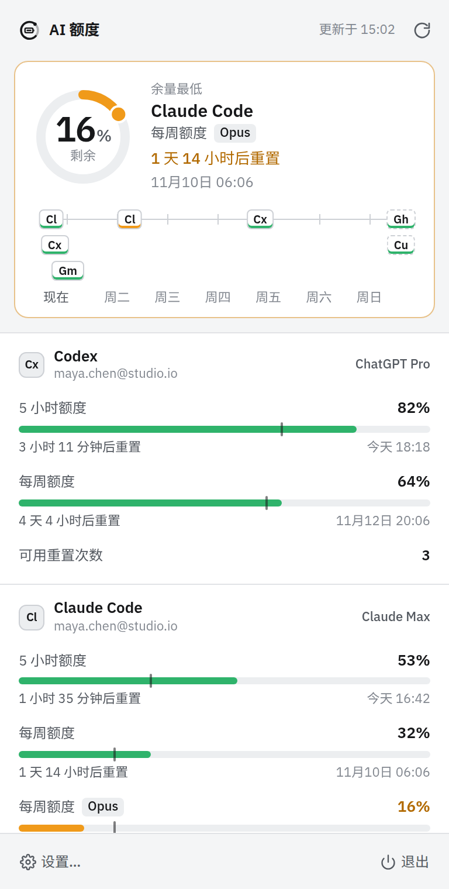
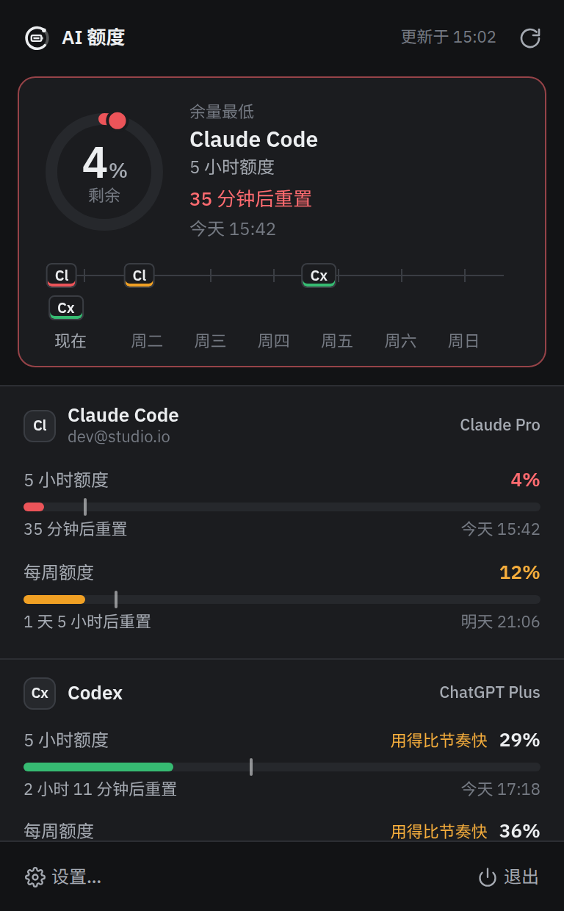
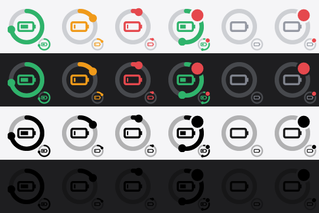
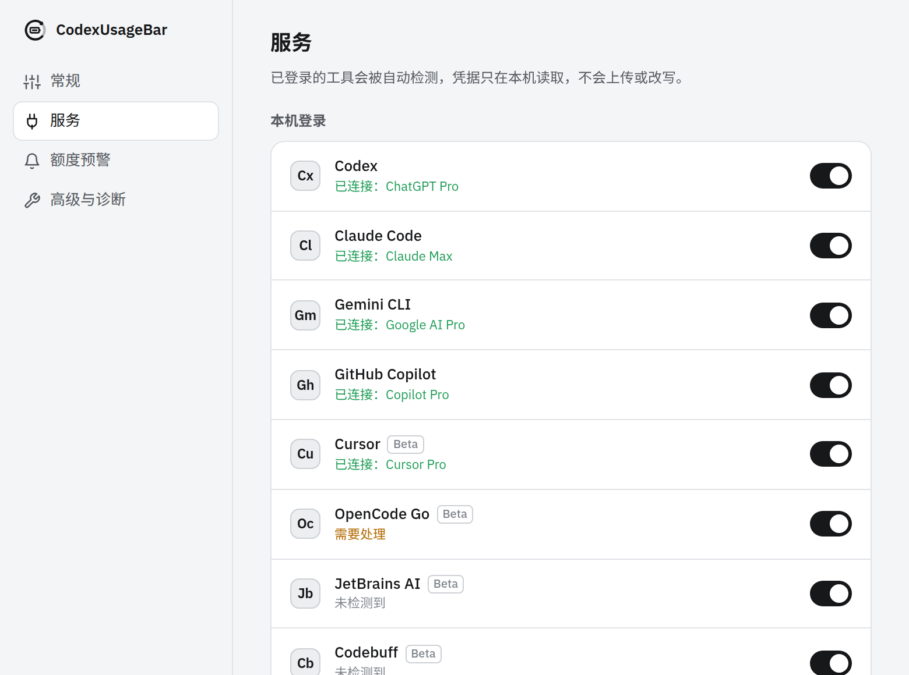

# CodexUsageBar

常驻托盘的 AI 额度表：一眼看清本机每个 AI 编程工具还剩多少额度、什么时候重置。支持 **macOS / Windows / Linux**。

<p>
  
  
</p>

## 功能

- **自动发现已登录的工具**：直接复用本机 CLI / 应用的登录，不需要重新授权。
- **剩余额度与重置时间**：每个额度窗口（5 小时、每日、每周、每月、按模型）都显示剩余百分比、倒计时和具体重置时刻。
- **重置时间线**：未来 7 天内各服务额度何时恢复，一条时间轴看完。
- **使用节奏**：进度条上的刻度表示按时间均匀消耗时“应剩”的位置；用得比节奏快会提示。
- **状态图标**：托盘圆环的长度等于全局最低余量，颜色随之变化（绿 / 琥珀 / 红），刷新失败时带红点角标。macOS 正常时使用模板图标融入菜单栏。
- **预警通知**：低于 20% / 10%（可调）时发系统通知，同一重置周期内只提醒一次；额度重置后可选提醒。
- **离线可用**：启动即显示上次的数据；网络失败时标记“数据已过期”而不是清空。
- **自动刷新**：1 / 5 / 15 / 30 分钟，睡眠唤醒后立即刷新，打开面板时数据超过 1 分钟也会刷新。
- 开机自启、浅色 / 深色 / 跟随系统、简体中文 / English。



## 支持的服务

| 服务 | 读取方式 | 显示内容 |
|---|---|---|
| **Codex** (ChatGPT) | `~/.codex/auth.json` → ChatGPT usage 接口；失败时回退到官方 `codex app-server` | 5 小时、每周额度，可用重置次数 |
| **Claude Code** | `~/.claude/.credentials.json`，macOS 为钥匙串 `Claude Code-credentials` | 5 小时、每周、Opus / Sonnet 每周额度 |
| **Gemini CLI** | `~/.gemini/oauth_creds.json` → Code Assist 配额接口 | 各模型每日剩余比例 |
| **GitHub Copilot** | Copilot 编辑器插件登录或 `gh` CLI 登录 | Premium 请求、Chat / 补全月度额度 |
| **OpenCode Go** (Beta) | `~/.local/share/opencode` 中的 CLI 登录 | 5 小时、每周、每月额度 |
| **Cursor** (Beta) | Cursor 桌面应用的本地登录（`state.vscdb`） | 当月套餐用量、按量付费余额 |
| **JetBrains AI** (Beta) | IDE 本地配额文件，无需联网 | 每月额度、充值余额 |
| **Codebuff** (Beta) | `~/.config/manicode/credentials.json` | 额度与余额 |
| OpenRouter、DeepSeek、Moonshot / Kimi、Z.ai / 智谱 GLM、MiniMax | 在设置中填写 API Key（或环境变量） | 余额、Coding Plan 额度 |

没有登录的服务不会出现在面板里；可在 **设置 → 服务** 中查看检测状态、单独关闭某个服务。



## 隐私

- 只读取本机已有的登录信息，直接请求各服务商的官方接口，不经过任何第三方服务器，没有统计或上报。
- 凭据只读：不会改写 `auth.json`、`.credentials.json` 等文件。Claude Code 令牌过期时提示你运行一次 `claude` 让它自己刷新；Gemini 的令牌只在内存中刷新。
- 与 v1 不同：为了支持多家服务，v2 会读取本地 OAuth 令牌（只读）来调用官方用量接口。
- API Key 保存在本机配置文件中（Linux / macOS 权限为 600）：
  - Linux `~/.config/codexusagebar/config.json`
  - macOS `~/Library/Application Support/codexusagebar/config.json`
  - Windows `%APPDATA%\codexusagebar\config.json`

## 安装

从 [Releases](https://github.com/robin421/CodexUsageBar/releases) 下载对应平台的安装包：macOS `.dmg`、Windows `.msi` / `.exe`、Linux `.deb` / `.AppImage`。

平台说明：

- **macOS**：只在菜单栏显示，不占 Dock；菜单栏文字模式可选“完整 / 紧凑 / 仅图标”。
- **Windows**：点击托盘图标打开面板；悬停可看到各服务摘要。
- **Linux**：托盘基于 AppIndicator。GNOME 需要安装 [AppIndicator 扩展](https://extensions.gnome.org/extension/615/appindicator-support/)。AppIndicator 不支持左键事件，请从托盘菜单选择“打开面板”。菜单中也直接列出了每个服务的最低余量。

## 命令行

核心库附带一个 CLI，便于排查或在脚本里使用：

```bash
cargo run -p quota-core --bin usagebar            # 人类可读
cargo run -p quota-core --bin usagebar -- --json  # JSON
cargo run -p quota-core --bin usagebar -- --all --en
```

## 开发

依赖：Rust stable、Node 20+；Linux 还需要 `libwebkit2gtk-4.1-dev libayatana-appindicator3-dev librsvg2-dev`。

```bash
npm install
npm run tauri dev      # 运行完整应用
npm run tauri build    # 打包安装包
cargo test -p quota-core
npm run check          # 前端类型检查
```

只调界面时可以直接 `npm run dev`，在浏览器打开 `http://localhost:1420/`，会使用内置的模拟数据：

- `?mock=rich|calm|critical|empty|loading|failed` 切换场景
- `&theme=light|dark`、`&lang=zh|en`
- `#/settings/general|providers|alerts|advanced` 打开设置页

### 目录结构

```
crates/quota-core/       各服务的额度读取（纯 Rust，不依赖界面，可单测）
  src/providers/         codex, claude, gemini, copilot, opencode, cursor, jetbrains, codebuff, keyed(API Key)
  src/icon.rs            托盘图标绘制
  src/alerts.rs          预警去重
  src/bin/usagebar.rs    命令行
src-tauri/               托盘、面板窗口、定时刷新、通知、设置
src/                     Svelte 界面（面板 + 设置）
  styles/tokens.css      设计变量（颜色、字号、间距、圆角、动效）
.github/workflows/       三平台构建
```

v1 的 macOS 原生 Swift 版本保留在 git 标签 `v1-swift`。
