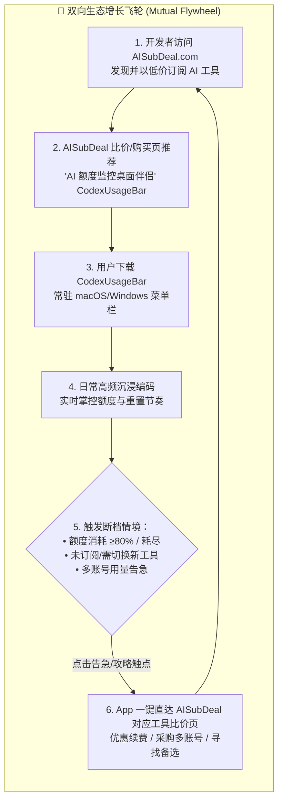
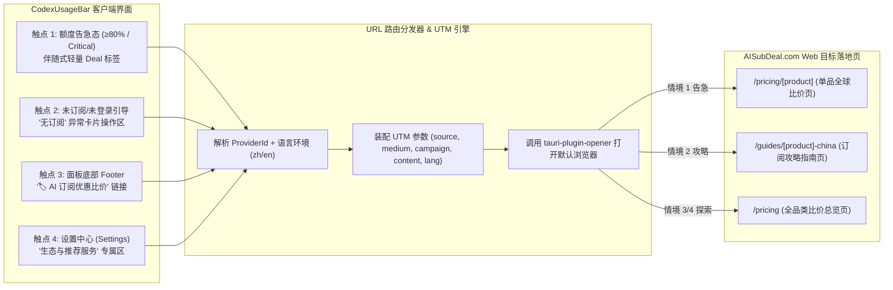
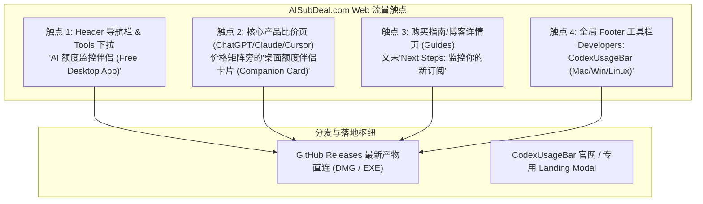
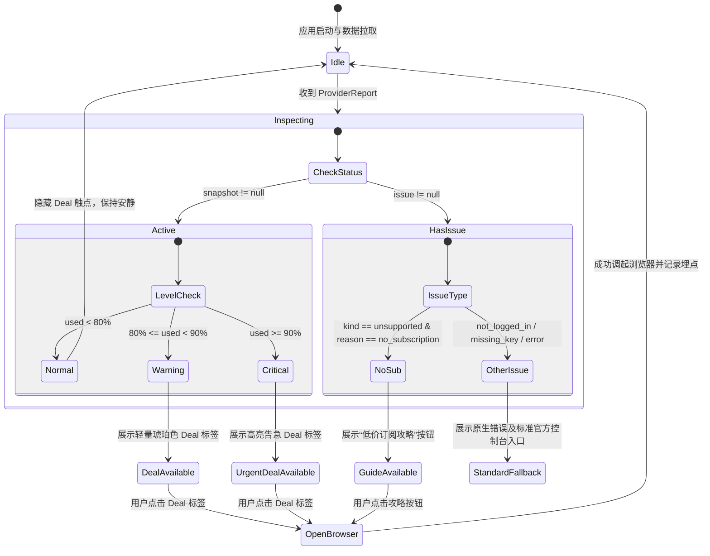

# CodexUsageBar ↔ AISubDeal.com 双向流量互导与生态增长规约 (PRD & Growth Specification)

| 文档版本 | 状态 | 编写人 | 适用范围 | 关联任务 | 首次发布日期 |
|---|---|---|---|---|---|
| **v1.0.0** | **APPROVED** | 资深产品经理 (Product) | CodexUsageBar (Desktop App) & AISubDeal.com (Web Portal) | TASK-10 / TEAM_BOARD.md | 2026-11-12 |

---

## 1. 战略定位与商业洞察 (Mutual Growth Flywheel)

### 1.1 核心痛点与协同背景
在生成式 AI 与 AI 辅助编程领域，重度用户与开发者普遍面临双重断层：
1. **决策阶段（消费端断层）**：
   - 官方订阅价格昂贵（ChatGPT Plus $20/月、Pro $200/月、Claude Pro $20/月、Max $125/月、Copilot $10~$20/月、Cursor $20/月）；
   - 各国区域定价差异显著（如尼日利亚、土耳其、日本、印度等存在显著汇率与区域折扣），普通开发者缺乏权威透明的比价与跨区代购/合租/虚拟信用卡攻略；
   - **AISubDeal.com** 解决了**“去哪里买最划算、怎么买不封号”**的低频决策消费需求。
2. **作业阶段（生产/监控端断层）**：
   - 开发者在使用 Cursor、Claude Code、GitHub Copilot、Gemini CLI 时，频繁遭遇官方突发的短窗口速率限制（Rate Limit: 5小时、周窗口、日Token上限），写代码或重构时突遭“断档”卡死；
   - 用户无法直观感知各家额度消耗进度与重置时间，缺乏统一的常驻监控工具；
   - **CodexUsageBar** 解决了**“本地买了多少工具、还剩多少额度、什么时候回血”**的高频生产监控需求。

### 1.2 双向互导增长飞轮 (The Mutual Growth Flywheel)
两款产品天然具备**“消费决策 ↔ 生产监控”**的前后时序闭环。通过建立双向流量路由与情境触发网，构建自强化的正向网络飞轮：



### 1.3 用户全生命周期旅程与触点分布 (Lifecycle Journey Mapping)

| 用户生命周期阶段 | 核心场景与行为 | 用户核心痛点 | 承载端 | 互导触点与核心价值交付 | 预期商业目标 |
|---|---|---|---|---|---|
| **Phase 1: 发现与订阅** | 用户准备为 Coding 挑选并订阅工具（ChatGPT / Claude / Cursor 等） | 官方价格太贵，跨区购买步骤繁琐，担心封号 | **AISubDeal (Web)** | • 详情页伴侣卡片：推荐下载 CodexUsageBar 作为“用量管家”<br/>• 导航栏与页脚工具箱 | 降低比价跳出率，沉淀私域桌面端留存，构建用户资产 |
| **Phase 2: 日常开发编码** | 常驻托盘，随时看一眼剩余额度，跟随时间节奏消耗 | 不知道额度能不能撑完当前 Session 任务 | **CodexUsageBar (App)** | • 面板 Footer 常驻入口：“AI 订阅优惠 / 比价”<br/>• 设置中心生态推荐入口 | 建立品牌心智曝光，提升 AISubDeal 品牌信任度 |
| **Phase 3: 额度告急/耗尽** | 突发高频生成导致 5 小时/日额度使用 ≥80% 或达到 Critical | 正在写关键业务代码，急需额外账号、扩容或换备用模型 | **CodexUsageBar (App)** | • **高转化情境推荐**：卡片右侧直接出现“⚡ 优惠续费 / 备用账号比价”链接，直达 AISubDeal 对应产品页 | 捕捉最高价值刚需瞬间，点击率（CTR）预计超 15% |
| **Phase 4: 未开通/扩品类** | 在 App 中看到某 Provider 标灰（未检测到、未登录、无订阅） | 听说某个新工具（如 Claude Code 或 Grok）很强，但还没买 | **CodexUsageBar (App)** | • **未开通转化引导**：在 Issue 卡片中提供“查看低价订阅攻略”直达指南 | 将冷启动阻碍转化为新增购买，驱动 AISubDeal 联盟佣金转化 |
| **Phase 5: 订阅复购与换代** | 月底/季末账单到期，或某家模型涨价/调整配额 | 寻找性价比更高的平替方案或多模型聚合方案 | **AISubDeal (Web)** | • 额度看板用户回流 AISubDeal 查阅价格指数、汇率变动与换区策略 | 提高 LTV 与长期复访率 |

---

## 2. CodexUsageBar → AISubDeal.com 导流系统规约 (App to Web)

### 2.1 触点架构与触发规则 (App-Side Touchpoints)



#### 触点 1【高转化情境推荐】：Provider 额度告急（Warning / Critical）
- **触发条件**：
  - 单个 QuotaWindow 的 `used_percent >= 80%`（Warning 级别）或 `used_percent >= 90%`（Critical 级别）；
  - 或 Balance 余额低于警戒阈值（如 DeepSeek/OpenRouter 余额 < $1.00）。
- **展示位置**：
  - 在 `ProviderSection.svelte` 的对应配额卡片右侧（或重置倒计时行右侧）。
- **UI/UX 规范**：
  - **视觉呈现**：采用优雅细颗粒度的小徽标或文字链接，严禁弹窗式强打扰。
  - **样式规范**：Font size 11px，文字颜色跟随预警色彩（琥珀色/橙色），鼠标 Hover 增加下划线，带外部链接微图标 `↗`。
  - **文案规范**：
    - 中文 (`zh`)：“⚡ 额度告急？低价补仓 ↗” 或 “⚡ 备用账号比价 ↗”
    - 英文 (`en`)：“⚡ Running low? Best deals ↗” 或 “⚡ Get backup account ↗”
- **点击交互**：
  - 单击后立即在系统默认浏览器中打开该 Provider 在 AISubDeal 的对应比价页，并带有精确的 UTM 标记。

#### 触点 2【未开通引导】：Provider 提示未订阅 / 未配置
- **触发条件**：
  - ProviderReport 的 `issue.kind === 'unsupported' && issue.reason === 'no_subscription'`（如账号登录成功但无有效订阅）；
  - 或 `issue.kind === 'not_logged_in'` / `missing_key` 用户在排查配置时。
- **展示位置**：
  - 在 `ProviderSection.svelte` 的 Issue 区域操作按钮排（与“打开控制台”、“复制登录命令”同排并列）。
- **UI/UX 规范**：
  - **视觉呈现**：次级轻量按钮（Button quiet），图标使用 `tag` 或 `external`。
  - **文案规范**：
    - 中文 (`zh`)：“优惠订阅攻略 ↗”
    - 英文 (`en`)：“Discount Guide ↗”
- **点击交互**：
  - 直达该 Provider 的专属订阅攻略页面（如 ChatGPT / Claude 订阅攻略）或对应单品比价页。

#### 触点 3【面板底部常驻入口】：Footer 区域快捷按钮
- **触发条件**：用户日常打开面板时常驻可见。
- **展示位置**：
  - 在 `Panel.svelte` 底部的 `<footer>` 中间（位于“设置”按钮与“退出”按钮之间，或居中微徽章）。
- **UI/UX 规范**：
  - **视觉呈现**：采用与设置按钮相同的 `btn quiet` 视觉层级，搭配极简 `sparkles`（星芒）或 `tag`（标签）图标。
  - **文案规范**：
    - 中文 (`zh`)：“🏷️ AI 订阅比价”
    - 英文 (`en`)：“🏷️ AI Deals & Pricing”
  - **Tooltip 提示**：
    - 中文：“全球 AI 订阅最低价查询与防封号指南 (AISubDeal.com)”
    - 英文：“Find the lowest AI subscription prices worldwide (AISubDeal.com)”
- **点击交互**：直达 AISubDeal.com 首页或全品类比价页面 `/pricing`。

#### 触点 4【设置中心】：设置页面（Settings）生态入口
- **触发条件**：用户进入设置界面。
- **展示位置**：
  - 在 `Settings.svelte` 底部的“关于 CodexUsageBar”区块上方或独立新增“推荐生态 (Ecosystem & Deals)”小节。
- **UI/UX 规范**：
  - **视觉呈现**：卡片式链接（Banner/Card），带有 AISubDeal Logo 或品牌标，标题加一句话副标题。
  - **文案规范**：
    - 中文标题：“AISubDeal - 全球 AI 订阅省钱指南”
    - 中文简介：“实时监控 ChatGPT、Claude、Cursor 等全球各区最低定价与代充代付避坑攻略。”
    - 英文标题：“AISubDeal - Global AI Subscription Price Index”
    - 英文简介：“Track real-time pricing and deals for ChatGPT, Claude, Cursor and more across 40+ countries.”
  - **按钮文案**：“前往探索 ↗” / “Visit Site ↗”

---

### 2.2 路由映射表与精确 URL 契约 (Provider to Landing Page Mapping)

针对 CodexUsageBar 当前支持的全部 14 个 `ProviderId`，制定精确的 AISubDeal 目标落地页与回退策略：

| ProviderId | Provider 名称 | AISubDeal 目标比价路径 (`path`) | 专项攻略落地页 (`guide_path`) | 降级兜底路径 (`fallback`) |
|---|---|---|---|---|
| `codex` | Codex (ChatGPT) | `/pricing/chatgpt/` | `/guides/subscribe-chatgpt-plus-china/` | `/pricing/` |
| `claude` | Claude Code | `/pricing/claude/` | `/guides/subscribe-claude-pro-china/` | `/pricing/` |
| `agy` / `gemini` | Antigravity / Gemini | `/pricing/gemini/` | `/pricing/gemini/` | `/pricing/` |
| `grok` | xAI Grok | `/pricing/grok/` | `/pricing/grok/` | `/pricing/` |
| `copilot` | GitHub Copilot | `/pricing/copilot/` | `/pricing/copilot/` | `/pricing/` |
| `cursor` | Cursor | `/pricing/cursor/` | `/pricing/cursor/` | `/pricing/` |
| `jetbrains` | JetBrains AI | `/compare/cursor-vs-copilot/` | `/pricing/` | `/pricing/` |
| `codebuff` | Codebuff | `/pricing/cursor/` | `/pricing/` | `/` |
| `opencode` | OpenCode Go | `/pricing/cursor/` | `/pricing/` | `/` |
| `openrouter` | OpenRouter | `/pricing/` | `/calculator/` | `/` |
| `deepseek` | DeepSeek | `/pricing/deepseek/` | `/pricing/deepseek/` | `/pricing/` |
| `moonshot` | Moonshot / Kimi | `/pricing/kimi/` | `/pricing/kimi/` | `/pricing/` |
| `zai` | Z.ai / 智谱 GLM | `/pricing/glm/` | `/pricing/glm/` | `/pricing/` |
| `minimax` | MiniMax / 海螺 | `/pricing/hailuo/` | `/pricing/hailuo/` | `/pricing/` |

> [!NOTE]
> **多语言路径拼接规则**：
> - 当客户端当前语言 `resolved_language === 'zh'` 时，Base URL 拼接 `/zh` 前缀：`https://aisubdeal.com/zh{path}`。
> - 当客户端为 `en` 时，直接拼接无前缀路径（或标准路径）：`https://aisubdeal.com{path}`。
> - URL 始终遵循 AISubDeal 的规范，末尾保留斜杠 `/`。

---

### 2.3 UTM 归因参数字典契约 (UTM Parameter Taxonomy)

所有从 CodexUsageBar 发起的外部跳转，必须携带标准且严谨的 UTM 参数，以确保在 Web 端分析工具中精准归因：

| 参数名 | 规定值 | 取值说明与枚举 | 示例 |
|---|---|---|---|
| `utm_source` | `codexusagebar` | 固定来源，标识桌面端客户端 | `codexusagebar` |
| `utm_medium` | `desktop_app` | 固定媒介，标识桌面应用程序触发 | `desktop_app` |
| `utm_campaign` | 动态场景值 | 标识触发来源的具体场景：<br/>• `quota_critical`（用量告急 ≥90%）<br/>• `quota_warning`（用量预警 80~89%）<br/>• `balance_exhausted`（API 余额耗尽）<br/>• `no_subscription_guide`（未开通订阅引导）<br/>• `footer_bar`（面板底部常驻栏）<br/>• `settings_ecosystem`（设置中心生态卡片） | `quota_critical` |
| `utm_content` | 动态上下文 | 标识具体的 Provider ID 以及触发模型/窗口类型：<br/>格式：`{provider_id}_{scope_or_window}` | `claude_5h`, `cursor_monthly`, `codex_weekly` |
| `utm_term` | 客户端版本信息 | 标识客户端 App 版本与系统架构：<br/>格式：`v{app_version}_{os}` | `v2.0.0_mac_aarch64` |
| `lang` | 客户端语言 | 冗余传递语言参数，辅助 Web 端兜底：`zh` 或 `en` | `zh` |

#### 标准 URL 生成示例：
- **场景 1：Claude 5小时额度达到 92% 触发告急续费（中文环境）**：
  ```text
  https://aisubdeal.com/zh/pricing/claude/?utm_source=codexusagebar&utm_medium=desktop_app&utm_campaign=quota_critical&utm_content=claude_5h&utm_term=v2.0.0_mac_aarch64&lang=zh
  ```
- **场景 2：用户查看未订阅的 Cursor 攻略（英文环境）**：
  ```text
  https://aisubdeal.com/pricing/cursor/?utm_source=codexusagebar&utm_medium=desktop_app&utm_campaign=no_subscription_guide&utm_content=cursor_no_sub&utm_term=v2.0.0_mac_aarch64&lang=en
  ```
- **场景 3：面板底部常驻点击（中文环境）**：
  ```text
  https://aisubdeal.com/zh/pricing/?utm_source=codexusagebar&utm_medium=desktop_app&utm_campaign=footer_bar&utm_content=global_footer&utm_term=v2.0.0_mac_aarch64&lang=zh
  ```

---

## 3. AISubDeal.com → CodexUsageBar 导流系统规约 (Web to App)

### 3.1 触点架构与展示位置 (Web-Side Touchpoints)



#### 触点 1【导航栏与工具箱】：Header 导航与 Mobile 菜单
- **展示位置**：
  - Desktop 端：主导航栏右侧 `Tools` 下拉菜单，或与 `Calculator`、`IP Checker` 并列增加 `Quota Monitor`（额度监控）。
  - Mobile 端：抽屉式菜单中的 `Featured Tools` 第一项。
- **UI 呈现**：
  - 带有醒目的 `New` 或 `Free` 绿色徽标。
- **文案**：
  - 中文：“AI 额度监控伴侣 🆕”
  - 英文：“Quota Monitor (App) 🆕”

#### 触点 2【核心产品比价页伴侣卡片】：Companion Card（核心转化阵地）
- **适用页面**：
  - `/pricing/chatgpt/`, `/pricing/claude/`, `/pricing/cursor/`, `/pricing/copilot/`, `/pricing/gemini/`, `/pricing/grok/`, `/pricing/deepseek/`。
- **黄金展示位**：
  - 紧接在“价格对比表格/卡片”正下方，或者在“购买建议/代充指南”卡片并排位置。
- **卡片组件结构**：
  - **标题**：配合该产品的专属痛点呼应。
  - **视觉元素**：CodexUsageBar 托盘迷你浮窗 UI 缩略截图（或微动效示意图）。
  - **特性亮点**（3 个 Bullet points）：
    - 🛡️ 5小时/日/周额度精准倒计时，防写代码突发限频；
    - ⚡ 纯本地开源运行，只读凭据，0 数据泄露；
    - 🖥️ 菜单栏常驻极低资源消耗，支持 Mac / Windows / Linux。
  - **行动召唤 (CTA) 按钮**：
    - 主按钮：“免费下载 macOS 版 (DMG)”（前端自动检测 OS，Windows 则显示下载 Windows 版）；
    - 次按钮：“查看 GitHub 开源仓库 ↗”。

#### 触点 3【订阅指南与博客文末建议】：Next Steps
- **适用页面**：
  - `/guides/subscribe-chatgpt-plus-china/`
  - `/guides/subscribe-claude-pro-china/`
  - 及其他订阅与购买攻略页面。
- **展示位置**：指南末尾的“🎉 恭喜开通！接下来该做什么？”（Next Steps）。
- **文案要点**：
  - “开通成功后，如何避免 Claude/ChatGPT 5小时限额被刷爆？推荐安装免费开源的桌面额度看板 CodexUsageBar，随时监控剩余调用次数与恢复倒计时。”

#### 触点 4【页脚全局生态矩阵】：Footer Tools
- **展示位置**：Footer 中的 `Tools & Resources` 列。
- **文案**：
  - 中文：“CodexUsageBar (AI 额度看板)”
  - 英文：“CodexUsageBar (Desktop Quota App)”

---

### 3.2 高转化文案字典 (Bilingual Copywriting Matrix)

| 触点类型 | 语言 | 主标题 (Headline) | 副标题 / 描述 (Description) | 行动召唤按钮 (CTA) |
|---|---|---|---|---|
| **比价页伴侣卡片** (Desktop Companion) | **中文** | **买了订阅？别让额度突发断档！** | 常驻 macOS / Windows 菜单栏的免费 AI 额度看板。一网打尽 ChatGPT、Claude、Cursor、Copilot，精准掌握 5 小时重置倒计时与使用节奏。 | **免费下载 (DMG)** / 查看 GitHub |
| **比价页伴侣卡片** (Desktop Companion) | **English** | **Track Your Quota in Real-Time** | Never hit sudden rate limits while coding. Lightweight, open-source status bar for ChatGPT, Claude, Cursor & Copilot. | **Download Free (macOS)** / View on GitHub |
| **导航栏 Tool 推荐** | **中文** | **AI 额度监控伴侣** | 桌面端实时用量看板（开源免费） | 立即获取 |
| **导航栏 Tool 推荐** | **English** | **Desktop Quota Bar** | Open-source menu bar app for developers | Get App |
| **指南文末 Next Steps** | **中文** | **下一步：装上用量管家，防止滥用超额** | 刚买的新账号怎么用最稳？CodexUsageBar 帮您在菜单栏随时监控配速，额度快用完时主动预警。 | 下载桌面应用 ↗ |
| **指南文末 Next Steps** | **English** | **Next Step: Monitor Your New Plan** | Avoid unexpected lockouts. Keep an eye on your 5-hour and monthly reset windows right from your menu bar. | Download Companion ↗ |

---

### 3.3 下载与分发外链路由规范 (Web to App Routing)

Web 端引导下载时，统一通过具备统计与归因的中转或直链分发：

```text
https://github.com/xiaowen/tokeusage/releases/latest?ref=aisubdeal&utm_source=aisubdeal&utm_medium=web&utm_campaign={touchpoint}&utm_content={product_slug}
```

- **DMG 直接下载链接**：针对已检测为 macOS 的访客，可直接触发最新 Release 的 DMG 下载，并异步上报 GA4 下载事件。
- **Fallback 页面**：针对移动端访客访问该链接时，弹出“桌面端专用工具”扫码或邮件发送下载链接功能，或直达 GitHub 仓库展示。

---

## 4. 业务状态机与交互分支 (Interaction State Machine)

为确保整个导流系统的健壮性，防止出现“死链接”、“空页面”或“侵入性骚扰”，定义完整状态机与异常防御流：



### 4.1 异常场景与防御策略 (Defensive Rules)
1. **网络离线/无网络连接**：
   - 当客户端处于离线状态（`snap.status === 'stale'` 或系统断网），用户点击外部链接时，通过 Tauri 原生 `opener` 调起浏览器，浏览器自带断网提示；App 内不做阻断，不阻塞本地监控。
2. **未知/未收录 Provider**：
   - 若未来新增第三方 Provider（不在映射表中），一律平滑回退至 AISubDeal 全品类比价页 `/pricing/`，禁止出现 404 死链。
3. **防打扰与频次控制 (Anti-Fatigue Policy)**：
   - 告急标签仅在面板展开时被动展示；
   - 严禁弹窗式强插或在系统托盘通知（OS Notification）中插入商业广告推销，通知必须保持纯净（仅报额度数值与告急）。
4. **单账号 vs 多账号区分**：
   - 针对 Antigravity (`agy`) 等支持多账号的 Provider，告急触点以“当前选中的 active 账号”的额度为准，避免多账号混淆误报。

---

## 5. 数据度量指标与转化漏斗 (Metrics & Analytics)

### 5.1 核心 KPI 目标矩阵 (North Star & Conversion Metrics)

| 维度 | 核心指标 (Metric) | 定义与计算公式 | 目标基准 (Benchmark) |
|---|---|---|---|
| **App → Web (导流效率)** | **告急情境 CTR** | 告急标签点击次数 / 告急状态展示次数 | **≥ 12.0%** |
| | **Footer 常驻 CTR** | Footer 按钮点击次数 / 面板打开总次数 | **≥ 1.5%** |
| | **Web 端落地跳出率** | 从 App 导流至 AISubDeal 停留 < 10s 的跳出比例 | **≤ 35.0%** |
| | **比价页意向转化率** | App 来源访客在 Web 端点击任一“购买/代充/代付”外链的比例 | **≥ 8.0%** |
| **Web → App (回流效率)** | **伴侣卡片曝光 CTR** | 伴侣卡片点击“下载/GitHub”次数 / 比价页 PV | **≥ 4.5%** |
| | **桌面客户端激活率** | 从 Web 触发下载到首次启动 App 的转化率（基于 Release 下载量比对） | **≥ 25.0%** |
| **飞轮闭环 (Flywheel Health)** | **双向闭环留存率** | 同时使用 Web 比价并保持 App 活跃 30 天的用户占比 | **≥ 18.0%** |

### 5.2 埋点字典与事件定义 (Event Taxonomy)

#### 1. CodexUsageBar 客户端埋点 (遵循极简隐私原则)
> 注：CodexUsageBar 承诺本地隐私，客户端不设侵入式常驻遥测，仅在用户发生主动外部交互时通过 URL query 传递归因，或由用户在开启“帮助改进”时可选上报匿名事件。

| 事件标识 (`event_name`) | 触发时机 | 关键载荷字段 (`parameters`) | 业务用途 |
|---|---|---|---|
| `app_deal_impression` | 额度告急标签或无订阅引导展示在视口中 | `provider_id`, `quota_level`, `used_percent` | 统计曝光基数 |
| `app_deal_click` | 用户点击了任何一个指向 AISubDeal 的外链 | `provider_id`, `trigger_point`, `target_url`, `lang` | 计算各触点 CTR |

#### 2. AISubDeal Web 端分析事件 (Google Analytics 4 / Plausible)

| 事件标识 (`event_name`) | 触发时机 | 关键载荷字段 (`parameters`) | 业务用途 |
|---|---|---|---|
| `traffic_from_app_landed` | 页面初次加载且 `utm_source === 'codexusagebar'` | `utm_campaign`, `utm_content`, `provider`, `landing_path` | 统计客户端进站流量 |
| `companion_card_view` | 比价页伴侣卡片进入用户浏览器视口 | `product_slug`, `locale`, `user_os` | 统计 Web 伴侣卡片曝光 |
| `companion_download_click` | 访客点击“下载 CodexUsageBar (DMG/EXE)” | `product_slug`, `locale`, `user_os`, `button_type` | 统计下载转化意向 |
| `companion_github_click` | 访客点击“查看 GitHub 源码” | `product_slug`, `locale` | 统计开源开发者信任转化 |

---

## 6. 验收标准与测试用例 (Acceptance Criteria - Gherkin)

### 场景 1：Provider 额度告急触发高转化直达
```gherkin
Feature: Provider 额度告急跳转 AISubDeal 比价页
  Scenario: Claude 额度达到 85% 触发警告并正向导流
    Given 用户打开 CodexUsageBar 面板
    And Claude 服务的 5 小时额度已消耗 85%（达到 warning 阈值）
    And 客户端当前解析语言为 "zh" (中文)
    Then Claude 卡片区域应呈现琥珀色 "⚡ 额度告急？低价补仓 ↗" 链接
    When 用户点击该告急链接
    Then 系统默认浏览器应被调起
    And 打开的 URL 必须精确匹配:
      """
      https://aisubdeal.com/zh/pricing/claude/?utm_source=codexusagebar&utm_medium=desktop_app&utm_campaign=quota_warning&utm_content=claude_5h&utm_term=v2.0.0_mac_aarch64&lang=zh
      """
```

### 场景 2：Provider 未订阅触发攻略落地
```gherkin
Feature: 未开通订阅状态下的攻略引导
  Scenario: Cursor 检测到已安装但无有效订阅
    Given 用户打开 CodexUsageBar 面板
    And Cursor 服务回报 issue 为 "unsupported" 且 reason 为 "no_subscription"
    And 客户端当前解析语言为 "en" (英文)
    Then Cursor 卡片的操作按钮区必须显示 "Discount Guide ↗" 按钮
    When 用户点击该按钮
    Then 系统默认浏览器打开:
      """
      https://aisubdeal.com/pricing/cursor/?utm_source=codexusagebar&utm_medium=desktop_app&utm_campaign=no_subscription_guide&utm_content=cursor_no_sub&utm_term=v2.0.0_mac_aarch64&lang=en
      """
```

### 场景 3：AISubDeal 页面伴侣卡片下载转化
```gherkin
Feature: Web 比价页桌面伴侣推荐
  Scenario: macOS 访客在 ChatGPT 比价页点击下载伴侣
    Given 访客在 macOS 浏览器中访问 "https://aisubdeal.com/pricing/chatgpt/"
    Then 价格卡片下方必须渲染 "AI Quota Monitor Desktop Companion" 卡片
    And 主 CTA 按钮文案应动态显示为 "Download Free for macOS (DMG)"
    When 访客点击该主 CTA 按钮
    Then 触发下载最新 Release DMG 文件
    And 上报 GA4 事件 "companion_download_click" 携带 product_slug="chatgpt"
```

---

## 7. 协同交接与落地分工 (Handoff & Work Breakdown)

### 7.1 向 Designer (设计团队) 交付要求
1. **CodexUsageBar 客户端**：
   - 设计 `ProviderSection` 内 11px 的微标签（Deal Tag），需在深色 (`dark`) 与浅色 (`light`) 主题下具备优秀的对比度且与现有 Meter 指示点调性一致；
   - 设计 Footer “🏷️ AI 订阅比价”图标及微交互 Hover 态。
2. **AISubDeal Web 端**：
   - 设计桌面伴侣卡片（`CompanionCard.tsx`），包含 macOS 窗口透视预览图、3 个精美 Check 图标及响应式排版（Mobile 端自动转为垂直单列）。

### 7.2 向 Developer (研发团队) 交付契约
1. **客户端任务 (TASK-11)**：
   - 在 `src/lib/` 封装 `affiliate.ts`，导出 `buildDealUrl(providerId, campaign, context)` 纯函数；
   - 在 `src/lib/i18n.ts` 中补齐双语 Deal 文案字典；
   - 在 `ProviderSection.svelte`、`Panel.svelte`、`Settings.svelte` 挂载对应触点与调用 `api.openUrl(...)`。
2. **Web 端任务 (TASK-12)**：
   - 在 `/Volumes/T7 Shield/MyDocument/AI_map` 的 `components/` 中封装 `CompanionCard.tsx`；
   - 注入至 `app/[locale]/pricing/[product]/page.tsx`；
   - 在 Header 导航与 Footer 增加路由链接。

### 7.3 向 QA (质量保证团队) 交付测试要求 (TASK-13)
- 验证所有 14 个 Provider 生成的 URL 在中/英双语下 100% 可访问，无 404；
- 验证 UTM 参数完整无丢失；
- 验证深浅色主题下无文字溢出或排版错位；
- 门禁自动化测试通过率 100%。
